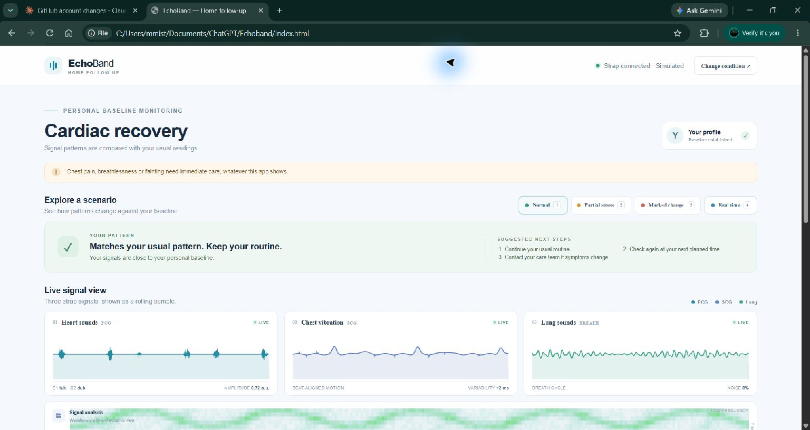
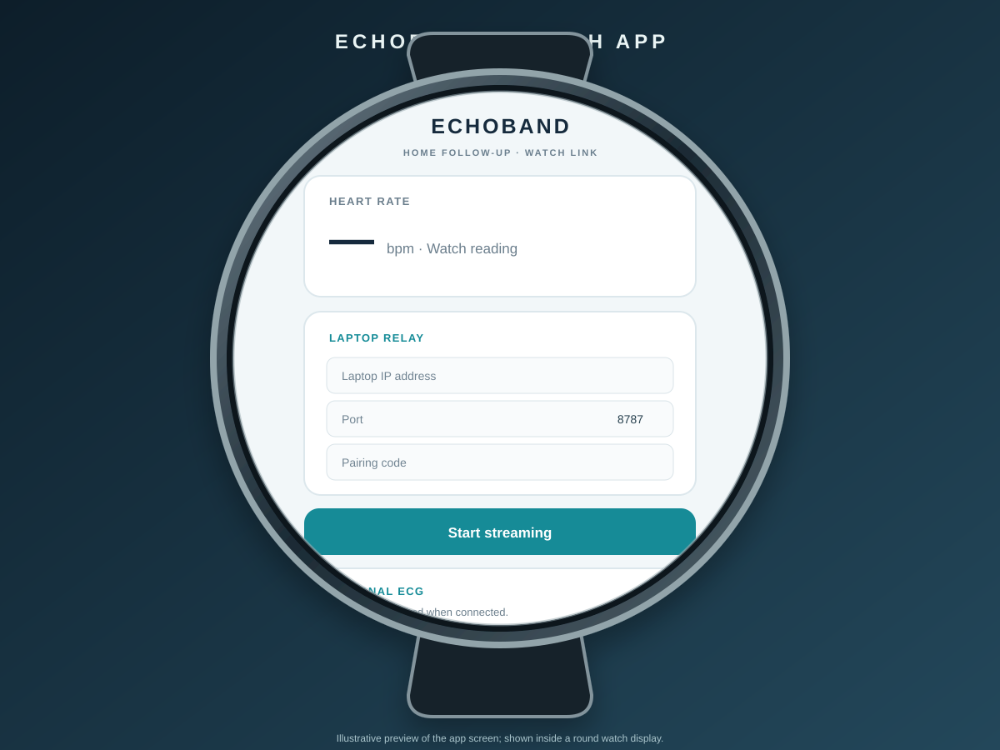

# EchoBand

EchoBand is a local-only hackathon demo. The original simulated dashboard still works by double-clicking `index.html`. Real-time mode adds a Samsung Galaxy Watch stream through a laptop relay; it uses the same baseline-relative status thresholds, card renderer, triage updater, and alert log as the scenario mode.

All thresholds and demo values are illustrative, not clinical. Consumer smartwatch signals are not clinically validated and do not diagnose disease.

## Screenshots

### Website dashboard



### Galaxy Watch app screen preview

This illustrative preview shows the watch app's relay setup and sensor controls inside a round watch display.



## Fast demo without a watch

1. Install Node.js 18 or newer.
2. In a terminal at the project root, install the relay's one Node dependency and start its sample replay:

   ```sh
   cd bridge
   npm install
   cd ..
   node bridge/server.js --demo
   ```

3. Double-click `index.html` or visit the Dashboard URL printed by the relay.
4. Select either condition, enter the printed pairing code, and click **Real time**. The replay learns a baseline for 60 valid samples, then proceeds through normal, partial-change, and marked-change readings. It sends one simulated ECG recording after the replay starts.

The dashboard's “Simulated relay sample” footer and copied report identify replay data as simulated. To use a physical watch, start the relay without `--demo`.

## Run with the Galaxy Watch4 Classic

### 1. Enable Samsung Health Sensor SDK developer mode

On the watch, open **Settings → Apps → Health Sensor Service** (some firmware labels it **Health Platform**). Tap the service name about ten times, enable **Developer mode**, and accept the Samsung Health Partner Service & SDK license. This mode is for development/testing; public distribution requires Samsung partner approval. The SDK supports Galaxy Watch4 and later running Wear OS powered by Samsung, but does not support the emulator.

Official Samsung instructions: [Health Sensor SDK overview and download](https://developer.samsung.com/health/sensor/overview.html), [developer mode](https://developer.samsung.com/health/sensor/guide/developer-mode.html), [permissions](https://developer.samsung.com/health/sensor/guide/permission-request.html).

### 2. Add the Samsung SDK AAR

Download the Samsung Health Sensor SDK from Samsung's official page and copy `samsung-health-sensor-api.aar` into:

```text
watch-app/app/libs/samsung-health-sensor-api.aar
```

Samsung requires this local AAR for sensor access; it is not included in this repository. The project uses SDK tracker types `HEART_RATE_CONTINUOUS`, `ACCELEROMETER_CONTINUOUS`, and `ECG_ON_DEMAND`.

### 3. Pair Android Studio to the watch over Wi-Fi

1. Put the watch and development computer on the same local Wi-Fi or phone hotspot.
2. On the watch, enable **Developer options → ADB debugging → Debug over Wi-Fi**. Use the watch's pairing screen/code in Android Studio's device pairing flow. If Android Studio asks for the watch's IP and pairing port, use the values shown on the watch's wireless debugging screen.
3. In Android Studio, choose **Open** and select the `watch-app` folder. Allow Gradle sync, select the paired watch, then run the `app` configuration. The app asks for sensor permissions at runtime.
4. Keep the watch app visible while streaming. It keeps the screen awake during a stream and omits invalid/off-wrist heart-rate readings.

### 4. Run the relay and connect the dashboard

1. In a terminal at the project root:

   ```sh
   cd bridge
   npm install
   cd ..
   node bridge/server.js
   ```

   The relay prints the laptop's private LAN dashboard URL, watch IP/port (`8787` by default), and a random six-character pairing code. It binds to the private LAN address and `127.0.0.1`; it does not bind to every interface.
2. Open `index.html` directly or visit the printed dashboard URL. Select a condition, enter the code in **Pairing code**, then choose **Real time** (keyboard shortcut `4`).
3. In the watch app, enter the laptop's printed IP address, port `8787`, and the same pairing code. Tap **Start streaming**.
4. The dashboard shows **Waiting for watch** until valid data arrives, then **Live** with the age of the latest reading. The first 60 valid heart-rate samples build the personal baseline.
5. On the watch, tap **Measure ECG · 30 s** and lightly touch the Home key as prompted. ECG is shown at the SDK's 500 Hz sampling rate. If the SDK reports it unavailable on the device or in the region, heart-rate streaming continues.

Press `1`, `2`, or `3`, or click a scenario button, to leave real-time mode and return to the simulated dashboard. No relay is needed for those scenarios.

## Local WebSocket message schema

Watch vitals (one packet per valid heart-rate update):

```json
{ "type": "vitals", "t": 1730000000000, "hr": 72, "hrStatus": 1, "ibi": [833, 840], "ibiStatus": [0, 0], "acc": { "x": 0.01, "y": -0.02, "z": 0.03 } }
```

- `hrStatus` is Samsung's heart-rate status; only `1` (successful) readings are streamed. Off-wrist (`-3`) and other invalid heart-rate readings are omitted.
- `ibi` values are milliseconds. Each value is sent only when its matching Samsung IBI status is `0` (valid), so the forwarded `ibiStatus` list contains corresponding zeroes.
- `acc` contains the latest accelerometer axes converted from Samsung raw counts to m/s². The watch samples the accelerometer at 25 Hz and includes the latest sample in the 1 Hz heart-rate packet.

ECG chunks and completion message:

```json
{ "type": "ecg", "fs": 500, "samples": [0.012, 0.018, -0.021], "leadOff": false, "done": false }
{ "type": "ecg", "fs": 500, "samples": [], "leadOff": false, "done": true }
```

Samsung specifies ECG at 500 Hz; `samples` are millivolts. `leadOff: true` indicates electrode contact is missing, and those samples are not forwarded. Relay control uses a separate `{ "type": "mode", "demo": true }` message only to identify sample-replay mode to the dashboard.

## Privacy and network notes

The watch, relay, and dashboard communicate over the local network. The relay holds connections and forwards frames in memory; it does not log or save health payloads, and no cloud/database is used. The random pairing code is required for each WebSocket connection. The relay prints connection/setup details but never payload contents.

Venue Wi-Fi often blocks device-to-device traffic with client isolation. A phone or laptop hotspot is usually the reliable option. If the computer has multiple private network adapters, set `ECHOBAND_HOST` to the correct private LAN IPv4 address before starting the relay.

## Troubleshooting

- **Permissions denied:** open the watch app's permissions in Settings and allow Body sensors, Activity recognition, and Samsung additional health data; reopen the app and tap **Start streaming**.
- **ECG unavailable:** the app reports the capability result and keeps heart-rate streaming. ECG capability varies by device/region. For a reading, keep the watch snug and touch the Home key lightly for the full 30 seconds.
- **No data / dashboard stuck on Waiting for watch:** make sure the relay and watch are running on the same network, re-enter the current pairing code, confirm the laptop IP/port, and wear the watch snugly. An off-wrist or poor-quality HR state is intentionally not streamed.
- **Relay does not start:** install Node.js 18+, run `npm install` inside `bridge`, and check whether port `8787` is already in use. Set `ECHOBAND_PORT` to another port and use the same port in the watch app if needed.
- **Firewall prompt / no connection:** allow Node.js inbound access on the private network for the chosen port. Do not expose the relay on a public network. If venue Wi-Fi isolates devices, switch to a phone/laptop hotspot.
- **Wrong network IP printed:** set `ECHOBAND_HOST` to the computer's private Wi-Fi IPv4 address. The server rejects non-private configured addresses.
- **SDK policy error:** verify Health Sensor Service developer mode is enabled and that the downloaded Samsung AAR matches the installed Health Sensor Service version. Samsung's [getting started guide](https://developer.samsung.com/health/sensor/guide/getting-started.html) covers service setup.
